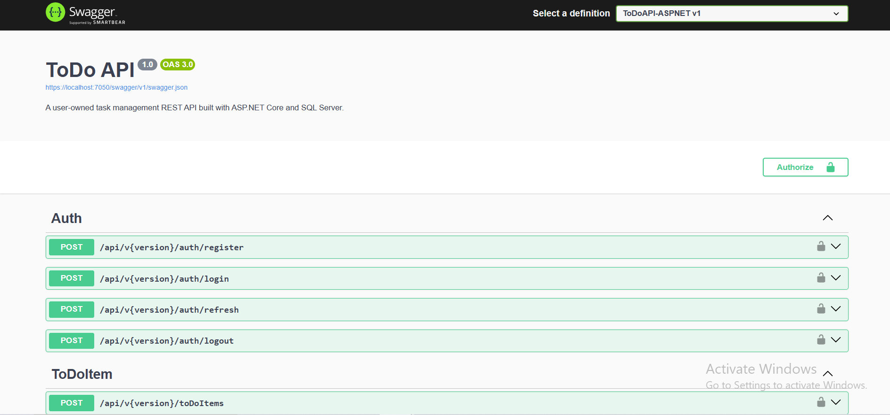
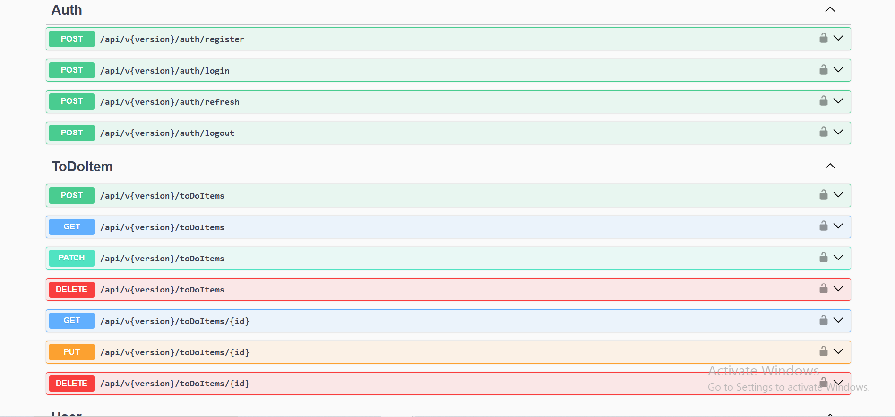

<h1 align="center">✅ ToDo API — Secure Task Management REST API</h1>

<p align="center">
  <b>An API-only, user-owned task management backend built with ASP.NET Core 8 Web API, Entity Framework Core 8, SQL Server, JWT access and refresh tokens, Swagger, Docker Compose, and xUnit.</b>
</p>

<p align="center">
  
  
  
  
  
  
  
</p>

---

## 📸 Project Screenshots

| Swagger API Documentation | Versioned API Endpoints |
|---|---|
|  |  |

---

## 🚀 Project Overview

**ToDo API** is a secure REST API for managing private, user-owned tasks. Users can register, log in, rotate refresh tokens, retrieve their profile, and create, read, update, complete, or delete their own to-do items.

The application uses a layered ASP.NET Core architecture with controllers, services, repositories, AutoMapper profiles, Entity Framework Core, and SQL Server. Authentication is handled with short-lived JWT access tokens and rotating refresh tokens. Passwords are hashed with BCrypt, refresh tokens are stored as SHA-256 hashes, and protected endpoints reject refresh tokens when they are incorrectly used as bearer credentials.

---

## 🎯 Project Purpose

This project demonstrates how to build and secure a practical ASP.NET Core backend while keeping data ownership, authentication, persistence, validation, and HTTP responsibilities separated.

It showcases:

- ASP.NET Core 8 Web API development
- Versioned REST endpoint design
- SQL Server persistence with Entity Framework Core
- Layered controller, service, and repository architecture
- JWT access-token authentication
- Rotating refresh-token workflow
- BCrypt password hashing
- SHA-256 refresh-token storage
- Per-user resource ownership
- Batch task operations with ownership validation
- Swagger/OpenAPI documentation
- EF Core migrations and SQL Server schema management
- Integration and service testing with xUnit and SQLite
- Local secret management through .NET User Secrets
- Optional Docker and Docker Compose execution

---

## ⭐ Key Highlights

- 🔐 Registration and login with BCrypt password hashing
- 🎟️ Separate access and refresh tokens with explicit `token_type` claims
- 🔄 Refresh-token rotation with expiry, revocation, and reuse prevention
- 🧂 Refresh tokens stored as SHA-256 hashes rather than raw values
- 🛡️ Protected endpoints accept access tokens and reject refresh tokens
- 👤 Authenticated `/users/me` profile endpoint
- ✅ User-owned task CRUD operations
- 🔒 Ownership isolation prevents access to another user's tasks
- 📦 Batch status updates and batch deletion
- 🧪 13 passing service, token, authorization, and HTTP pipeline tests
- 🗃️ Five verified Entity Framework Core migrations
- 📘 Swagger/OpenAPI documentation with Bearer-token authorization
- 🐳 Optional SQL Server and API containers through Docker Compose
- 🔑 Secret-safe local configuration through .NET User Secrets

---

## ✨ Features

### 🔐 Authentication & Token Security

| Feature | Description |
|---|---|
| Registration | Creates a new user and returns an access/refresh token pair |
| Login | Validates BCrypt password hashes and issues a new token pair |
| Access Token | Short-lived JWT used to authenticate protected endpoints |
| Refresh Token | Longer-lived JWT used only for token rotation and logout |
| Token-Type Enforcement | JWT middleware rejects refresh tokens on protected routes |
| Refresh Rotation | Refreshing returns a new pair and revokes the previous refresh token |
| Reuse Prevention | A rotated or revoked refresh token cannot be used again |
| Secure Storage | Refresh-token values are SHA-256 hashed before database persistence |
| Logout | Revokes the supplied active refresh token |
| Configuration Validation | Startup rejects missing, invalid, or weak JWT settings |

### ✅ User-Owned Task Management

| Feature | Description |
|---|---|
| Create Task | Creates a task owned by the authenticated user |
| List Tasks | Returns only tasks belonging to the authenticated user |
| Get by ID | Retrieves one owned task |
| Update Task | Updates an owned task's title, description, status, and due date |
| Batch Status | Updates the completion status of multiple owned tasks |
| Delete by ID | Deletes one owned task |
| Batch Delete | Deletes multiple owned tasks |
| Ownership Protection | Another user's task is not exposed through read, update, or delete operations |
| Persisted IDs | Create and list responses include database-generated task IDs |
| Validation | DTO and controller validation reject invalid request payloads |

### 🌐 API & Developer Experience

| Area | Implementation |
|---|---|
| API Version | Version `1.0` under `/api/v1` |
| Documentation | Swagger/OpenAPI with Bearer-token support |
| Serialization | Newtonsoft.Json with enum-string and null-handling configuration |
| Mapping | AutoMapper profiles for authentication, users, and tasks |
| CORS | Explicit configured-origin allowlist |
| Error Handling | Safe API responses without exposing connection strings or stack traces |
| HTTP Examples | Ready-to-edit requests in `ToDoAPI-ASPNET.http` |
| Local Tooling | Pinned `dotnet-ef` 8.0.10 tool manifest |

---

## 🛠 Technology Stack

| Layer | Technologies |
|---|---|
| Runtime | .NET 8 |
| Backend | ASP.NET Core 8 Web API, C# |
| ORM | Entity Framework Core 8.0.10 |
| Database | Microsoft SQL Server |
| Authentication | ASP.NET Core JWT Bearer |
| Password Security | BCrypt.Net-Next 4.0.3 |
| Token Storage | SHA-256 refresh-token hashes |
| Mapping | AutoMapper 13.0.1 |
| API Versioning | Microsoft.AspNetCore.Mvc.Versioning 5.1.0 |
| API Documentation | Swagger / Swashbuckle 6.6.2 |
| JSON | Newtonsoft.Json |
| Testing | xUnit 2.9.2, ASP.NET Core MVC Testing, SQLite in-memory |
| Coverage Tool | coverlet.collector 6.0.2 |
| Containers | Docker, Docker Compose, SQL Server 2022 image |
| EF CLI | Local `dotnet-ef` 8.0.10 tool manifest |

---

## 🏗 Architecture Overview

The backend follows a layered structure that separates HTTP concerns, business rules, data access, and persistence.

```text
Swagger / API Client
        ↓
ASP.NET Core Controllers
        ↓
Application Services
        ↓
Repository Interfaces
        ↓
Entity Framework Core Repositories
        ↓
SQL Server Database
```

AutoMapper profiles translate between API DTOs and database entities, while dependency injection connects controllers, services, and repositories.

### Layer Responsibilities

| Layer | Responsibility |
|---|---|
| `Controllers` | HTTP routing, authorization, request validation, logging, and status-code mapping |
| `Services` | Authentication, token rotation, task workflow, and ownership rules |
| `Repositories` | Entity Framework Core queries and persistence |
| `Models/Dtos` | Request and response contracts |
| `Models/Entities` | SQL Server entities and relationships |
| `Models/Config` | JWT configuration binding |
| `MappingProfiles` | AutoMapper mappings between DTOs and entities |
| `Data` | `DataContext` and EF Core entity configuration |
| `Migrations` | SQL Server schema history |
| `ToDoAPI-ASPNET.Tests` | Service, authorization, token, and HTTP pipeline verification |

---

## 📁 Repository Structure

```text
ToDoAPI-ASPNET/
├── docs/
│   └── screenshots/
│       ├── api.png
│       └── swagger.png
├── ToDoAPI/
│   ├── .config/
│   │   └── dotnet-tools.json
│   ├── Controllers/
│   │   ├── AuthController.cs
│   │   ├── ToDoItemController.cs
│   │   ├── UserController.cs
│   │   └── Utils/
│   ├── Data/
│   │   ├── DataContext.cs
│   │   └── Setup.cs
│   ├── MappingProfiles/
│   ├── Migrations/
│   ├── Models/
│   │   ├── Config/
│   │   ├── Dtos/
│   │   ├── Entities/
│   │   ├── Response/
│   │   └── Utils/
│   ├── Repositories/
│   │   ├── Auth/
│   │   ├── ToDoItems/
│   │   └── Users/
│   ├── Services/
│   │   ├── Auth/
│   │   ├── ToDoItems/
│   │   ├── Users/
│   │   └── Utils/
│   ├── Properties/
│   │   └── launchSettings.json
│   ├── ToDoAPI-ASPNET.Tests/
│   ├── .dockerignore
│   ├── .env.example
│   ├── appsettings.json
│   ├── appsettings.Development.json
│   ├── appsettings.Development.example.json
│   ├── docker-compose.yml
│   ├── Dockerfile
│   ├── ToDoAPI-ASPNET.csproj
│   ├── ToDoAPI-ASPNET.http
│   └── ToDoAPI-ASPNET.sln
├── .gitignore
├── LICENSE
└── README.md
```

> Generated `bin`, `obj`, test-result, publish, private `.env`, and local secret files should remain untracked.

---

## 🗃 Database Model

| Table | Purpose |
|---|---|
| `Users` | Stores account identity, BCrypt password hash, and timestamps |
| `ToDoItems` | Stores user-owned tasks, completion state, optional due date, and timestamps |
| `Tokens` | Stores hashed refresh-token values, type, revocation state, expiry, and ownership |
| `__EFMigrationsHistory` | Tracks applied Entity Framework Core migrations |

### Relationships

```text
Users 1 ──────── * ToDoItems
Users 1 ──────── * Tokens
```

Deleting a user cascades to that user's tasks and stored tokens through the configured database relationships.

### Applied Migrations

```text
20241225171952_InitialCreate
20241226130654_UpdateTokenEntity
20241226185029_UpdateUserToSet
20241226194154_FixNamingConvention
20241228115901_UpdateToDoItemUserIdToSet
```

---

## 🔄 Application Flows

### Registration & Login

```text
Client submits registration or login request
        ↓
Controller validates the request DTO
        ↓
Auth service verifies account rules or BCrypt password
        ↓
Access and refresh JWTs are generated
        ↓
Refresh token is SHA-256 hashed
        ↓
Hash, expiry, type, and user ownership are stored in SQL Server
        ↓
Token pair is returned to the client
```

### Refresh-Token Rotation

```text
Client submits current refresh token
        ↓
Stored SHA-256 hash and JWT signature are validated
        ↓
Token type, user, expiry, and revocation state are checked
        ↓
Current refresh token is revoked
        ↓
New access and refresh tokens are generated
        ↓
New refresh-token hash is stored
        ↓
New token pair is returned
```

### Protected Task Request

```text
Client sends Authorization: Bearer <access-token>
        ↓
JWT middleware validates signature, issuer, audience, expiry, and token_type
        ↓
Controller reads the authenticated user ID
        ↓
Service enforces task ownership
        ↓
Repository queries or changes SQL Server data
        ↓
Safe API response is returned
```

---

## 🔌 API Endpoints

### Authentication

| Method | Endpoint | Authentication | Purpose |
|---|---|---|---|
| `POST` | `/api/v1/auth/register` | Public | Register a user and receive a token pair |
| `POST` | `/api/v1/auth/login` | Public | Log in and receive a token pair |
| `POST` | `/api/v1/auth/refresh` | Public | Rotate a valid refresh token |
| `POST` | `/api/v1/auth/logout` | Public | Revoke an active refresh token |

### User

| Method | Endpoint | Authentication | Purpose |
|---|---|---|---|
| `GET` | `/api/v1/users/me` | Bearer access token | Return the authenticated user's profile |

### To-Do Items

| Method | Endpoint | Authentication | Purpose |
|---|---|---|---|
| `POST` | `/api/v1/toDoItems` | Bearer access token | Create an owned task |
| `GET` | `/api/v1/toDoItems` | Bearer access token | List owned tasks |
| `GET` | `/api/v1/toDoItems/{id}` | Bearer access token | Retrieve one owned task |
| `PUT` | `/api/v1/toDoItems/{id}` | Bearer access token | Update one owned task |
| `PATCH` | `/api/v1/toDoItems` | Bearer access token | Batch-update task completion status |
| `DELETE` | `/api/v1/toDoItems/{id}` | Bearer access token | Delete one owned task |
| `DELETE` | `/api/v1/toDoItems` | Bearer access token | Batch-delete owned tasks |

### Documentation

| Method | Endpoint | Availability | Purpose |
|---|---|---|---|
| `GET` | `/swagger` | Development | Open Swagger UI |
| `GET` | `/swagger/v1/swagger.json` | Development | Return the OpenAPI document |

### Common HTTP Responses

| Status | Meaning |
|---|---|
| `200 OK` | Request completed successfully |
| `201 Created` | User or task was created |
| `204 No Content` | Logout, status update, or delete succeeded |
| `400 Bad Request` | Validation, login, token, or batch request failed |
| `401 Unauthorized` | Missing, invalid, expired, or wrong token type |
| `404 Not Found` | Requested owned resource does not exist |
| `500 Internal Server Error` | Unexpected server error returned through a safe response |

---

## 🔐 Security & Reliability

| Area | Implementation |
|---|---|
| Passwords | BCrypt hashes are stored instead of raw passwords |
| Access Tokens | Short-lived JWTs configured in hours |
| Refresh Tokens | Longer-lived JWTs configured in days |
| Refresh Storage | Only SHA-256 hashes are stored in SQL Server |
| Rotation | Refreshing revokes the previous token and issues a new pair |
| Reuse Prevention | Revoked refresh tokens cannot be rotated again |
| Token Separation | `token_type=access` is required by protected endpoints |
| JWT Validation | Signature, issuer, audience, lifetime, and expiration are validated |
| Signing Key | Base64Url key must decode to at least 32 bytes |
| Ownership | Users can access only their own tasks |
| Batch Safety | Batch ownership is validated before applying changes |
| Configuration | Missing database and JWT settings stop startup clearly |
| CORS | Browser origins must be explicitly configured |
| Migrations | Automatic startup migration is disabled unless explicitly enabled |
| Errors | Raw SQL, stack traces, connection strings, and exception details are not returned to clients |
| Tests | Service and integration tests verify security-critical behavior |

> This is a portfolio-grade backend. A production release would still require centralized secret storage, rate limiting, email verification, password recovery, account lockout, monitoring, audit logging, backups, deployment hardening, and an operational security review.

---

## ⚙️ Installation Guide — Windows PowerShell

### Requirements

- Windows 10 or Windows 11
- PowerShell 5.1 or PowerShell 7+
- .NET 8 SDK, or a newer SDK with the .NET 8 runtime installed
- Microsoft SQL Server, SQL Server Developer Edition, SQL Server Express, or LocalDB
- Git
- Optional: Docker Desktop for the container workflow

Verify the installed tools:

```powershell
dotnet --version
dotnet --list-runtimes
git --version
```

Confirm that the runtime list includes:

```text
Microsoft.NETCore.App 8.x.x
Microsoft.AspNetCore.App 8.x.x
```

### 1️⃣ Open the Repository

After cloning, open PowerShell from the repository root:

```powershell
$RepoRoot = (Get-Location).Path
$ApiRoot = Join-Path $RepoRoot 'ToDoAPI'
$ProjectFile = Join-Path $ApiRoot 'ToDoAPI-ASPNET.csproj'
$SolutionFile = Join-Path $ApiRoot 'ToDoAPI-ASPNET.sln'

Set-Location -LiteralPath $ApiRoot
```

### 2️⃣ Verify SQL Server

```powershell
$SqlService = Get-Service -Name 'MSSQLSERVER' -ErrorAction SilentlyContinue

if ($SqlService) {
    $SqlService | Format-Table Name, DisplayName, Status -AutoSize
}
```

For a running default SQL Server instance:

```powershell
$SqlServer = $env:COMPUTERNAME
```

For SQL Server Express, use:

```powershell
$SqlServer = "$env:COMPUTERNAME\SQLEXPRESS"
```

For LocalDB, use:

```powershell
$SqlServer = '(localdb)\MSSQLLocalDB'
```

### 3️⃣ Configure Local Development Secrets

Set the development environment:

```powershell
$env:ASPNETCORE_ENVIRONMENT = 'Development'
$env:DOTNET_ENVIRONMENT = 'Development'
```

Initialize .NET User Secrets only when the project does not already contain a `UserSecretsId`:

```powershell
$HasUserSecrets = Select-String `
    -Path $ProjectFile `
    -Pattern '<UserSecretsId>' `
    -Quiet

if (-not $HasUserSecrets) {
    dotnet user-secrets init --project $ProjectFile
}
```

Create the SQL Server connection string:

```powershell
$DatabaseName = 'ToDoDb'

$ConnectionString = "Server=$SqlServer;Database=$DatabaseName;Trusted_Connection=True;MultipleActiveResultSets=true;TrustServerCertificate=True"
```

Generate a secure Base64Url JWT key:

```powershell
$JwtBytes = New-Object byte[] 64

$RandomGenerator = [Security.Cryptography.RandomNumberGenerator]::Create()
$RandomGenerator.GetBytes($JwtBytes)
$RandomGenerator.Dispose()

$JwtKey = [Convert]::ToBase64String($JwtBytes).
    TrimEnd('=').
    Replace('+', '-').
    Replace('/', '_')
```

Store the local configuration:

```powershell
dotnet user-secrets set `
    'ConnectionStrings:DefaultConnection' `
    $ConnectionString `
    --project $ProjectFile

dotnet user-secrets set `
    'JWT:Key' `
    $JwtKey `
    --project $ProjectFile

dotnet user-secrets set `
    'JWT:Issuer' `
    'ToDoAPI' `
    --project $ProjectFile

dotnet user-secrets set `
    'JWT:Audience' `
    'ToDoAPI.Client' `
    --project $ProjectFile

dotnet user-secrets set `
    'JWT:AccessTokenExpiry' `
    '1' `
    --project $ProjectFile

dotnet user-secrets set `
    'JWT:RefreshTokenExpiry' `
    '30' `
    --project $ProjectFile

dotnet user-secrets set `
    'Database:ApplyMigrationsOnStartup' `
    'false' `
    --project $ProjectFile

dotnet user-secrets set `
    'Cors:AllowedOrigins:0' `
    'http://localhost:3000' `
    --project $ProjectFile

dotnet user-secrets set `
    'Cors:AllowedOrigins:1' `
    'http://localhost:5173' `
    --project $ProjectFile
```

Do not commit a populated JWT key, database password, `.env`, or local secret store.

### 4️⃣ Restore and Build

```powershell
Set-Location -LiteralPath $ApiRoot

dotnet restore $SolutionFile
dotnet tool restore

dotnet build `
    $SolutionFile `
    --configuration Release `
    --no-restore
```

Expected result:

```text
Build succeeded.
```

### 5️⃣ Run the Automated Tests

```powershell
dotnet test `
    $SolutionFile `
    --configuration Release `
    --no-build
```

Verified result:

```text
Test summary: total: 13, failed: 0, succeeded: 13, skipped: 0
```

### 6️⃣ Apply Entity Framework Core Migrations

Apply all existing migrations to the exact configured database:

```powershell
dotnet ef database update `
    --project $ProjectFile `
    --startup-project $ProjectFile `
    --connection $ConnectionString
```

Verify their applied status:

```powershell
dotnet ef migrations list `
    --project $ProjectFile `
    --startup-project $ProjectFile `
    --connection $ConnectionString
```

Applied migrations are displayed without `(Pending)`.

> Do not create a new initial migration. The repository already includes the complete migration history.

### 7️⃣ Trust the Local HTTPS Certificate

```powershell
dotnet dev-certs https --trust
dotnet dev-certs https --check --trust
```

### 8️⃣ Run the API

```powershell
Set-Location -LiteralPath $ApiRoot

$env:ASPNETCORE_ENVIRONMENT = 'Development'
$env:DOTNET_ENVIRONMENT = 'Development'

dotnet run `
    --project $ProjectFile `
    --launch-profile https
```

Local URLs:

```text
HTTPS API: https://localhost:7050
HTTP API:  http://localhost:5118
Swagger:   https://localhost:7050/swagger
OpenAPI:   https://localhost:7050/swagger/v1/swagger.json
```

Keep the PowerShell window open while the backend is running. Stop it with `Ctrl+C`.

---

## ▶️ Normal Daily Startup

Only one PowerShell window is required because the repository has no separate frontend.

```powershell
$RepoRoot = 'C:\path\to\ToDoAPI-ASPNET'
$ApiRoot = Join-Path $RepoRoot 'ToDoAPI'
$ProjectFile = Join-Path $ApiRoot 'ToDoAPI-ASPNET.csproj'

Set-Location -LiteralPath $ApiRoot

$env:ASPNETCORE_ENVIRONMENT = 'Development'
$env:DOTNET_ENVIRONMENT = 'Development'

dotnet run `
    --project $ProjectFile `
    --launch-profile https
```

Open Swagger:

```powershell
Start-Process 'https://localhost:7050/swagger'
```

---

## 🧪 Testing

Run the complete test suite from the API directory:

```powershell
dotnet test `
    '.\ToDoAPI-ASPNET.sln' `
    --configuration Release
```

Generate cross-platform code-coverage data:

```powershell
dotnet test `
    '.\ToDoAPI-ASPNET.sln' `
    --configuration Release `
    --collect:'XPlat Code Coverage'
```

The 13 tests cover:

- Access-token lifetime and user claims
- Authorization requirement on the task controller
- Access-token acceptance through the real JWT middleware
- Refresh-token rejection on protected endpoints
- Persisted task IDs in create and list HTTP responses
- Registration and hashed refresh-token storage
- Login and token-pair creation
- Refresh-token rotation and reuse prevention
- Logout and token revocation
- CRUD operations for the owning user
- Cross-user ownership isolation
- Batch status update ownership validation
- Empty batch-delete validation

---

## 🐳 Optional Docker Setup

The Docker workflow is located inside `ToDoAPI`.

```powershell
Set-Location -LiteralPath $ApiRoot

Copy-Item `
    -LiteralPath '.env.example' `
    -Destination '.env' `
    -Force

notepad '.env'
```

Replace every placeholder in `.env`, then validate and start the containers:

```powershell
docker compose config
docker compose up --build
```

Container API URL:

```text
http://localhost:8080
```

The committed Compose configuration uses the `Production` environment, so Swagger is disabled by default in the container workflow.

Stop and remove the containers:

```powershell
docker compose down
```

To delete the database volume as well:

```powershell
docker compose down --volumes
```

> `APPLY_MIGRATIONS_ON_STARTUP=true` is appropriate only for controlled local demonstrations. Reviewed migrations should be applied separately in production environments.

---

## 🧾 Example Authentication Usage

### Register

```http
POST /api/v1/auth/register
Content-Type: application/json

{
  "email": "developer@example.com",
  "username": "developer",
  "firstName": "Muhammad",
  "lastName": "Nawaz",
  "password": "StrongPass123!",
  "rePassword": "StrongPass123!"
}
```

### Log In

```http
POST /api/v1/auth/login
Content-Type: application/json

{
  "email": "developer@example.com",
  "password": "StrongPass123!"
}
```

### Authorize a Protected Request

```http
GET /api/v1/toDoItems
Authorization: Bearer YOUR_ACCESS_TOKEN
```

Use the access token—not the refresh token—in Swagger's **Authorize** dialog.

---

## 👨‍💻 Author

**Muhammad Ali Nawaz**  
ASP.NET Developer

---

## 📄 License

This project is open-source software licensed under the [MIT License](LICENSE).

---

<p align="center">
  <b>⭐ If this project helps you, consider starring the repository!</b>
</p>
